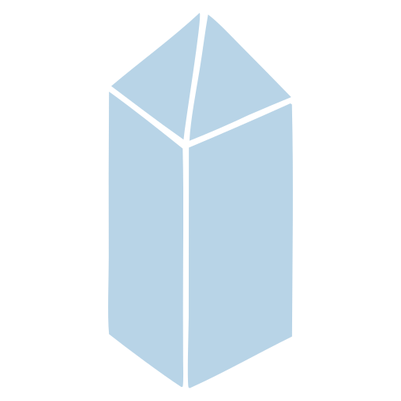

<h1 align="center">
  
   Selenite
</h1>

  Minimalistic immutable server OS for containers.
   Built on <a href="http://atomic.alt-gnome.ru">ALT Atomic</a>.

## About

Selenite is an immutable server operating system designed for running container workloads. It keeps the base system read-only and updates it atomically as a whole image, while applications are deployed via standard Podman Compose stacks.

For more details, visit [seleniteos.ru](https://seleniteos.ru).

### Highlights

- **Immutable base** — the read-only system is updated atomically as a whole image.
- **Declarative config** — machine state is described in a single YAML and applied with one command.
- **Minimal attack surface** — restricted API over SSH instead of an interactive shell, rootless containers, RBAC.
- **Familiar compose stacks** — deploy applications from standard `compose.yml` files.

### Requirements

- RAM: 256 MB
- Disk: 4 GB

### Documentation

See the [documentation](https://seleniteos.ru/guide/intro) on the Selenite website.

## License

[MPL-2.0](LICENSE)
