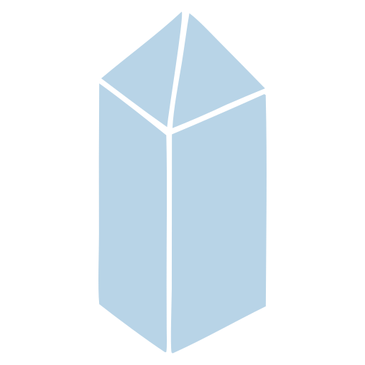

<h1 align="center">
  
   Selenite
</h1>

  Минималистичная иммутабельная серверная ОС для контейнеров.
   Построена на базе <a href="https://alt-atomic.org">ALT Atomic</a>.

<!--  -->

## О проекте

Selenite — иммутабельная серверная операционная система, предназначенная для запуска контейнерных нагрузок. Базовая система доступна только для чтения и обновляется атомарно целым образом, а приложения разворачиваются через стандартные стеки Podman Compose.

Подробнее на [seleniteos.ru](https://seleniteos.ru).

### Основные возможности

- **Неизменяемая основа** — базовая система доступна только для чтения и обновляется целым образом.
- **Декларативная конфигурация** — состояние машины описывается в едином YAML и применяется одной командой.
- **Минимальная поверхность атаки** — ограниченный API поверх SSH вместо интерактивного shell, rootless-контейнеры и RBAC.
- **Привычные compose-стеки** — разворачивайте приложения из стандартных `compose.yml`.

### Минимальные требования

- ОЗУ: 256 МБ
- Диск: 4 ГБ

### Документация

См. [документацию](https://seleniteos.ru/guide/intro) на сайте Selenite.

## Лицензия

[MPL-2.0](LICENSE)
